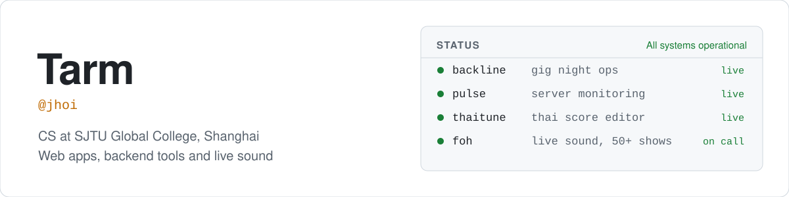

<picture>
  <source media="(prefers-color-scheme: dark)" srcset="assets/header-dark.svg">
  
</picture>

I'm a first-year Computer Science student at SJTU Global College. I build web apps and backend tools, and I've spent four years mixing live sound (50+ shows, FOH, monitors and RF). Most of my projects start from a problem I actually had, at a gig or on a server.

### Featured

<table>
  <tr>
    <td width="45%"></td>
    <td>
      <h4><a href="https://github.com/Tarmk/backline">Backline</a></h4>
      Run a multi-band gig night from one link. Bands send input lists and stage plots from their phone, the organiser gets a gear check and print sheets, and on the night every phone shows what's on now and how late things are running. English and 中文.  
      Next.js 16 · TypeScript · PostgreSQL · Drizzle · Vitest · Docker 
      <a href="https://backline-nine-delta.vercel.app">Live demo</a> · <a href="https://github.com/Tarmk/backline">Code</a>
    </td>
  </tr>
  <tr>
    <td width="45%"></td>
    <td>
      <h4><a href="https://github.com/Tarmk/pulse">Pulse</a></h4>
      Self-hosted monitoring for small groups of Linux servers. A dependency-free agent buffers metrics through outages, the server stores rollups in SQLite and sends alerts with hysteresis to Discord, webhooks or WeChat.  
      Python · FastAPI · SQLite · Docker 
      <a href="https://tarmk.github.io/pulse/">Demo</a> · <a href="https://github.com/Tarmk/pulse">Code</a>
    </td>
  </tr>
  <tr>
    <td width="45%"></td>
    <td>
      <h4><a href="https://thaitune.com">ThaiTune</a></h4>
      A platform for composing, sharing and exploring traditional Thai music scores, with notation editing through Flat.io.  
      Next.js · TypeScript · Firebase 
      <a href="https://thaitune.com">thaitune.com</a> · <a href="https://github.com/Tarmk/Thai-Tune">Code</a>
    </td>
  </tr>
</table>

### More projects

| Project | What it does | Built with |
|---|---|---|
| [Squash Referee](https://squash-ref.vercel.app) | Scoring, serve tracking and tournaments for squash referees, with match transcripts | Next.js, Firebase |
| [Past Papers Archive](https://al-papers.vercel.app) | A-Level past papers with mark schemes, plus about 8,900 questions sorted into printable topic sheets | React, Vite |
| [2048 Solver](https://github.com/Tarmk/2048-Solver) | Expectimax, Minimax and MCTS on a bitboard engine. Expectimax reaches 2048 in 20 of 20 games | Python |
| [Attention Tracker](https://github.com/Tarmk/FaceDetect) | YOLOv8 face detection and pupil tracking that scores attention frame by frame | Python, OpenCV |
| [Krutoo Calendar Sync](https://github.com/Tarmk/KrutooPlannerApple) | Scrapes a school timetable into iCloud Calendar over CalDAV | Python, Playwright |
| [Don't Step On It](https://minesweeper-one-kohl.vercel.app) | Minesweeper that turns into an escape maze after five clicks. Hack Club Twist entry | JavaScript |

Every public project here runs its tests or checks in CI on each push.

### Now

Learning C++ and Linux systems, joining the sound team at SJTU's Art Center, and improving my written Chinese.

Python · TypeScript · React · Next.js · FastAPI · PostgreSQL · SQLite · Docker · Linux
